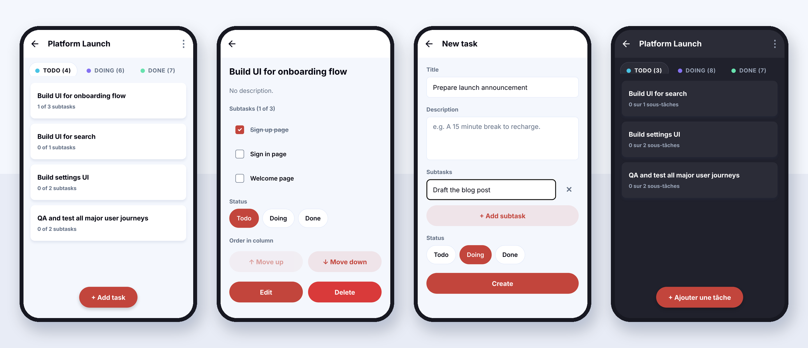
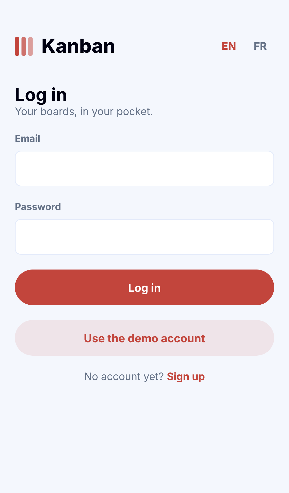
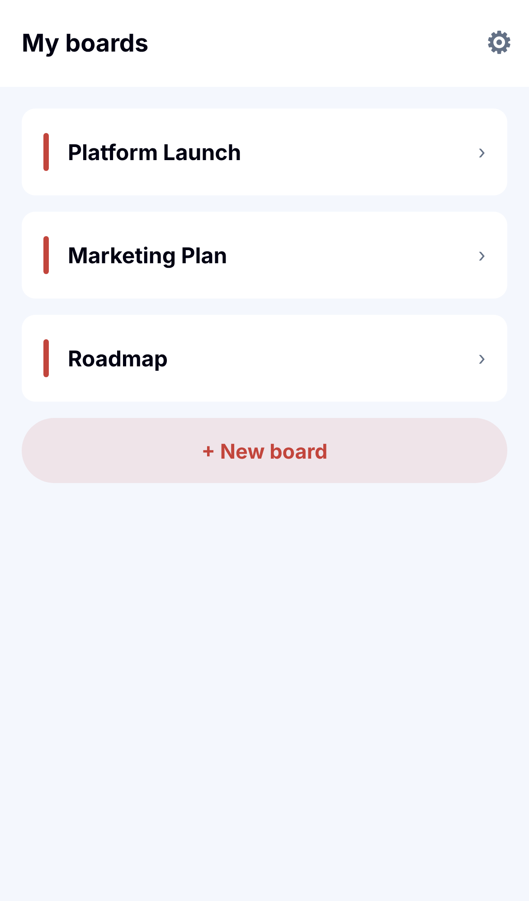
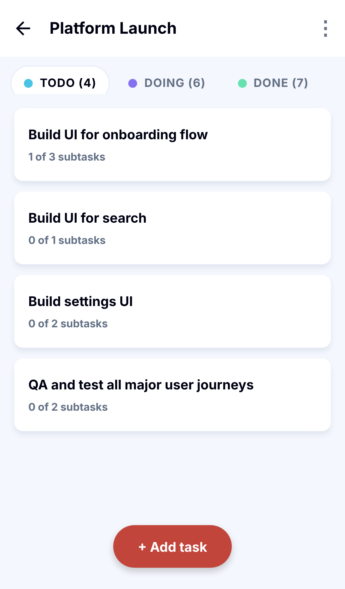
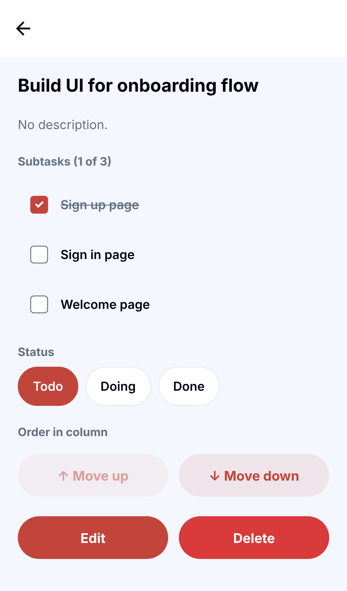
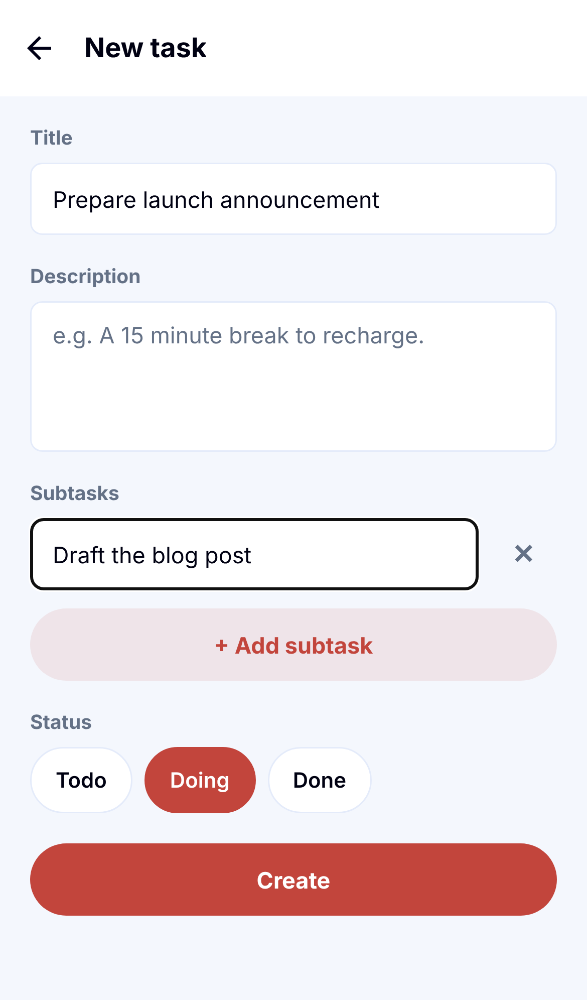
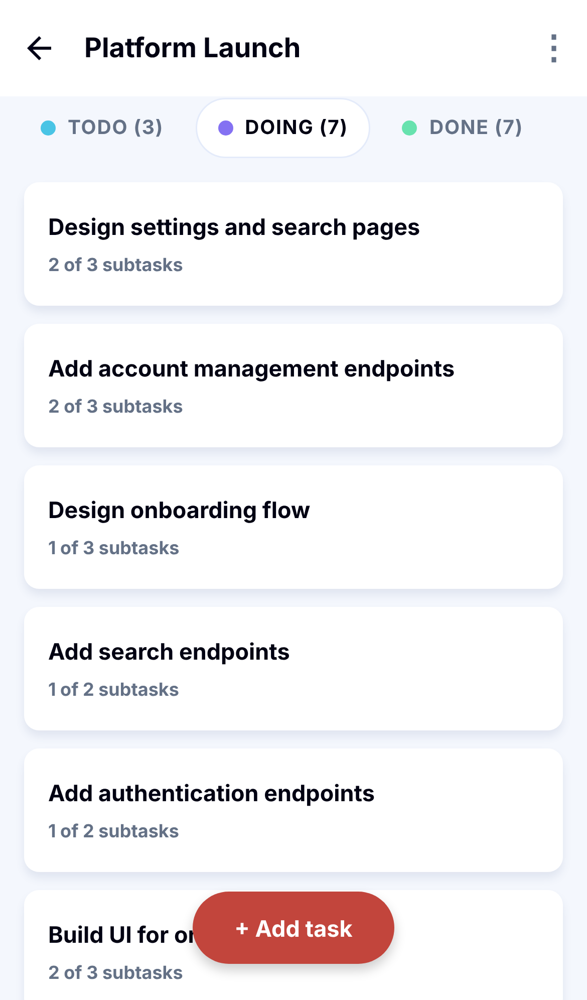
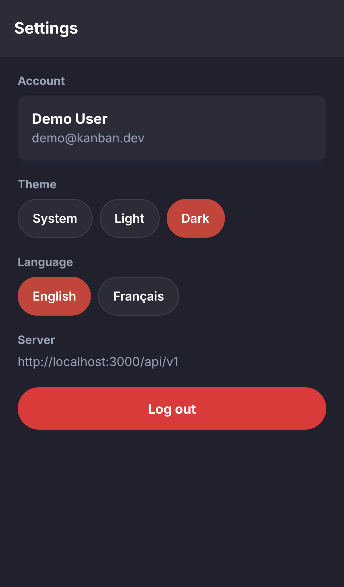
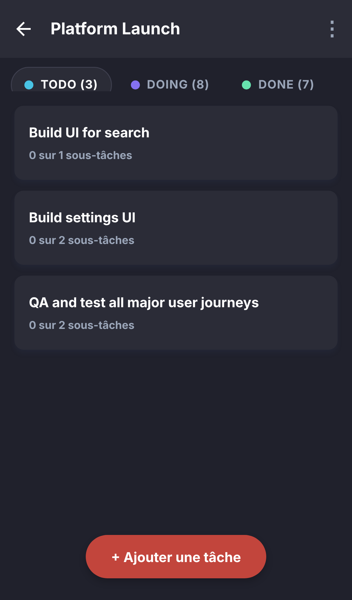
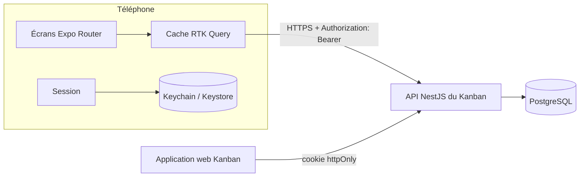

<div align="center">

# 📱 Kanban Mobile

**Le gestionnaire de tâches Kanban pour iOS et Android.**
Expo + React Native + TypeScript · même compte et mêmes tableaux que l'[application web](https://github.com/your-github-username/Latest-Kanban-Projet) · français et anglais.

[](https://github.com/your-github-username/Kanban-Application-Mobile/actions/workflows/ci.yml)


[English](README.md) · **Français**



</div>

---

## Sommaire

- [Présentation](#présentation)
- [Fonctionnalités](#fonctionnalités)
- [Captures d'écran](#captures-décran)
- [Stack technique](#stack-technique)
- [Installation](#installation)
- [Architecture](#architecture)
- [Sécurité](#sécurité)
- [Tests](#tests)
- [Structure du projet](#structure-du-projet)
- [Feuille de route](#feuille-de-route)
- [Licence](#licence)

## Présentation

Kanban Mobile est l'application compagnon du [gestionnaire de tâches Kanban](https://github.com/your-github-username/Latest-Kanban-Projet). Les deux applications utilisent **la même API NestJS** : une tâche créée sur le téléphone apparaît dans le navigateur, et inversement.

Organisez vos projets en tableaux et en colonnes (*À faire → En cours → Terminé*), ouvrez une tâche pour cocher ses sous-tâches, et faites-la avancer d'un simple toucher.

<p align="center"></p>

## Fonctionnalités

- 🔐 **Comptes** : inscription, connexion, reprise automatique de la session, déconnexion
- 🗂️ **Tableaux** : créer, renommer, supprimer ; ajouter, renommer, réordonner et supprimer des colonnes
- 👆 **Colonnes** : onglets avec le nombre de tâches, glisser à gauche et à droite entre les colonnes, tirer pour actualiser
- ✅ **Tâches et sous-tâches** : créer, modifier, supprimer, cocher les sous-tâches, progression sur chaque carte
- ↕️ **Déplacer les tâches** : changer le statut d'un toucher, réordonner avec *Monter / Descendre*, mise à jour instantanée (optimiste)
- 🌍 **Français / anglais**, selon la langue du téléphone par défaut
- 🌗 **Thème clair / sombre / système**
- ♿ **Accessible** : chaque contrôle a un rôle, un libellé et un état pour VoiceOver / TalkBack ; zones tactiles de 44 pt ; contrastes WCAG AA
- 🧪 **33 tests automatisés** et intégration continue à chaque push

## Captures d'écran

| Connexion | Tableaux | Tableau | Tâche |
|---|---|---|---|
|  |  |  |  |
| **Nouvelle tâche** | **Après déplacement** | **Réglages (sombre)** | **Français, sombre** |
|  |  |  |  |

## Stack technique

| Domaine | Technologie |
|---|---|
| Application | Expo SDK 58, React Native 0.88, React 19, TypeScript (strict) |
| Navigation | Expo Router (routes par fichiers, routes protégées, modales) |
| Données | Redux Toolkit Query (cache, mises à jour optimistes), Redux Toolkit |
| Stockage | `expo-secure-store` (Keychain / Keystore) |
| i18n | Dictionnaires français/anglais intégrés, `expo-localization` |
| Backend | [API NestJS du Kanban](https://github.com/your-github-username/Latest-Kanban-Projet) (`/auth/mobile/*` + jeton Bearer) |
| Tests | Jest (`jest-expo`), React Native Testing Library, utilitaires de test d'Expo Router |
| Qualité | ESLint, Prettier, GitHub Actions |

## Installation

### Prérequis

- **Node.js 24** (voir `.nvmrc`)
- L'**API Kanban** démarrée. Suivez les étapes backend du [projet web](https://github.com/your-github-username/Latest-Kanban-Projet/blob/main/README.fr.md#installation) (`npm run seed` crée le compte de démo).
- Pour lancer sur un téléphone : l'application gratuite **Expo Go** ([iOS](https://apps.apple.com/app/expo-go/id982107779) / [Android](https://play.google.com/store/apps/details?id=host.exp.exponent)), ou un simulateur iOS / émulateur Android.

### 1. Installer

```bash
npm install
cp .env.example .env
```

### 2. Indiquer l'adresse de l'API

Modifiez `EXPO_PUBLIC_API_URL` dans `.env` :

| Où tourne l'application | Valeur |
|---|---|
| Simulateur iOS ou web | `http://localhost:3000/api/v1` |
| Émulateur Android | `http://10.0.2.2:3000/api/v1` |
| Votre téléphone avec Expo Go | `http://<IP de votre ordinateur>:3000/api/v1` (même Wi-Fi) |

### 3. Démarrer

```bash
npm start          # puis scannez le QR code avec Expo Go, ou appuyez sur i / a / w
```

Connectez-vous avec **Utiliser le compte de démo** (`demo@kanban.dev` / `Demo1234`), ou créez votre compte.

## Architecture



- **Session.** Au démarrage, l'application lit le jeton dans le stockage sécurisé. Les routes protégées d'Expo Router affichent la connexion ou l'application selon la session, sans jamais montrer un écran privé par erreur.
- **Session expirée.** Toute réponse `401` de l'API déconnecte l'utilisateur, supprime le jeton et vide le cache.
- **Interface optimiste.** Cocher une sous-tâche ou déplacer une tâche met l'écran à jour immédiatement, et revient en arrière si le serveur refuse.

## Sécurité

| Sujet | Traitement |
|---|---|
| Stockage du jeton | `expo-secure-store` : Keychain iOS / Keystore Android, chiffré, jamais en AsyncStorage en clair |
| Transport du jeton | Uniquement l'en-tête `Authorization: Bearer` ; la connexion mobile ne dépose aucun cookie |
| Jeton expiré ou révoqué | Détecté au premier `401` : session effacée, jeton supprimé, retour à la connexion |
| Mots de passe | Vérifiés sur l'appareil avec les mêmes règles que l'API, hachés avec scrypt côté serveur, jamais stockés sur le téléphone |
| Protection côté serveur | Connexion limitée en tentatives, propriétaire vérifié à chaque requête, validation des entrées (voir la [section sécurité de l'API](https://github.com/your-github-username/Latest-Kanban-Projet/blob/main/README.fr.md#sécurité)) |

> En production, servez l'API en **HTTPS**. iOS et Android bloquent le HTTP simple par défaut hors développement.

## Tests

```bash
npm test            # 33 tests
npm run test:ci     # avec la couverture
npm run typecheck
npm run lint
```

Les tests affichent les **vrais écrans via Expo Router** face à une fausse API en mémoire, et couvrent :

- **Authentification :** connexion, mauvais mot de passe, erreur réseau, inscription, e-mail déjà utilisé, reprise de session, jeton expiré
- **Tableaux :** liste, ouverture, onglets, création avec validation, renommage et ajout de colonne, suppression avec confirmation
- **Tâches :** détail, cocher des sous-tâches, changer de statut, Monter / Descendre, création, modification, suppression
- **Réglages :** thème, langue, déconnexion ; un utilisateur déconnecté ne voit jamais un écran privé
- **Utilitaires :** règles de validation, traductions complètes, logique de déplacement optimiste

## Structure du projet

```
.
├── app/                     Écrans (Expo Router : un fichier = une route)
│   ├── _layout.tsx          Fournisseurs + navigation protégée
│   ├── login.tsx, signup.tsx
│   ├── boards/index.tsx     Liste des tableaux
│   ├── boards/[boardId].tsx Tableau : onglets de colonnes + balayage
│   ├── task/[taskId].tsx    Détail d'une tâche (modale)
│   ├── task-form.tsx        Créer / modifier une tâche (modale)
│   ├── board-form.tsx       Créer / modifier un tableau (modale)
│   └── settings.tsx
├── src/
│   ├── api/                 Endpoints RTK Query et types
│   ├── store/               Store, session, persistance du jeton
│   ├── components/          Composants accessibles (boutons, champs, puces, fenêtres…)
│   ├── i18n/                Messages français et anglais
│   ├── theme/               Palettes claire / sombre
│   └── features/            Validation des formulaires
├── __tests__/               Tests des écrans et unitaires
├── test/                    Fausse API, rendu de test, simulation du stockage sécurisé
└── assets/                  Icône et écran de démarrage
```

## Feuille de route

- [ ] Glisser-déposer par appui long (React Native Gesture Handler + Reanimated)
- [ ] Mode hors ligne avec synchronisation en arrière-plan
- [ ] Notifications push pour les échéances
- [ ] Versions pour les stores avec EAS (TestFlight / Play Console)

## Licence

Distribué sous [licence MIT](LICENSE).
