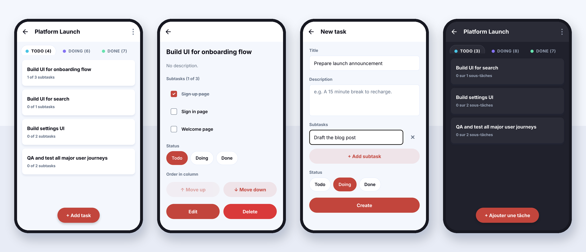
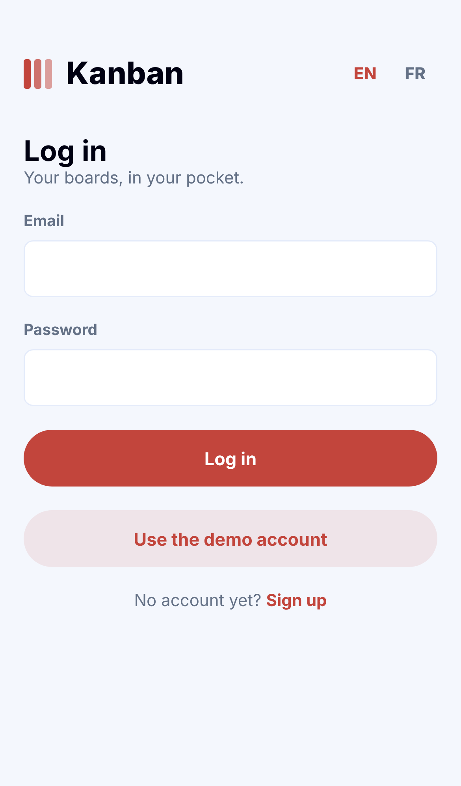
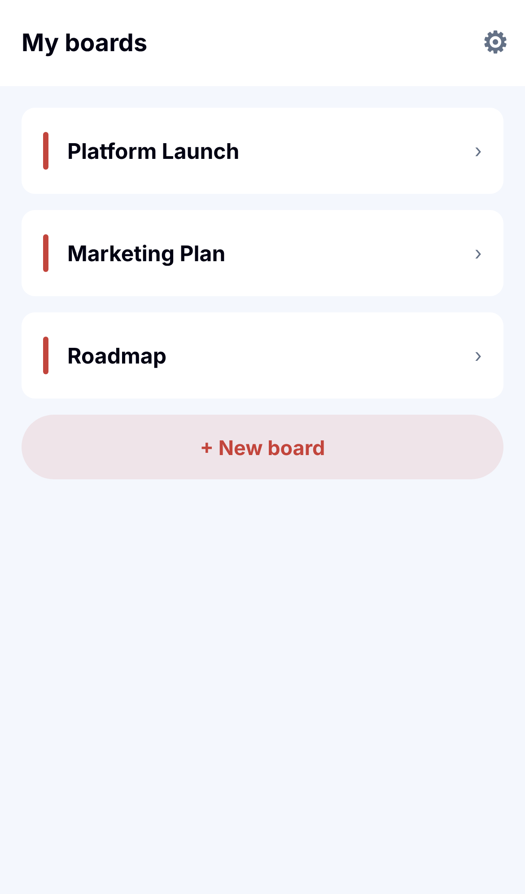
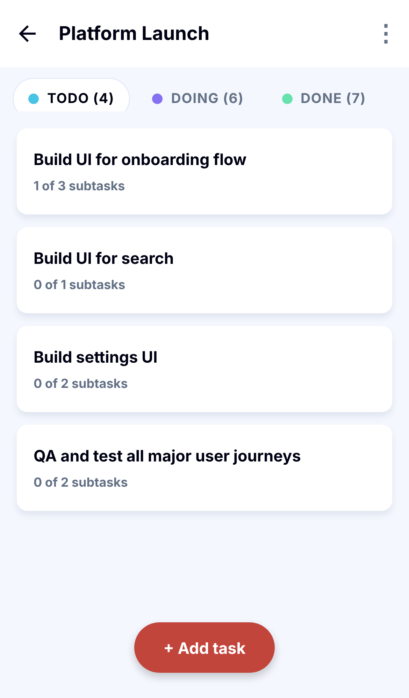
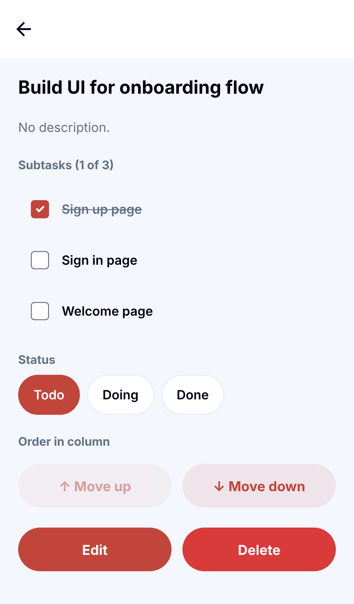
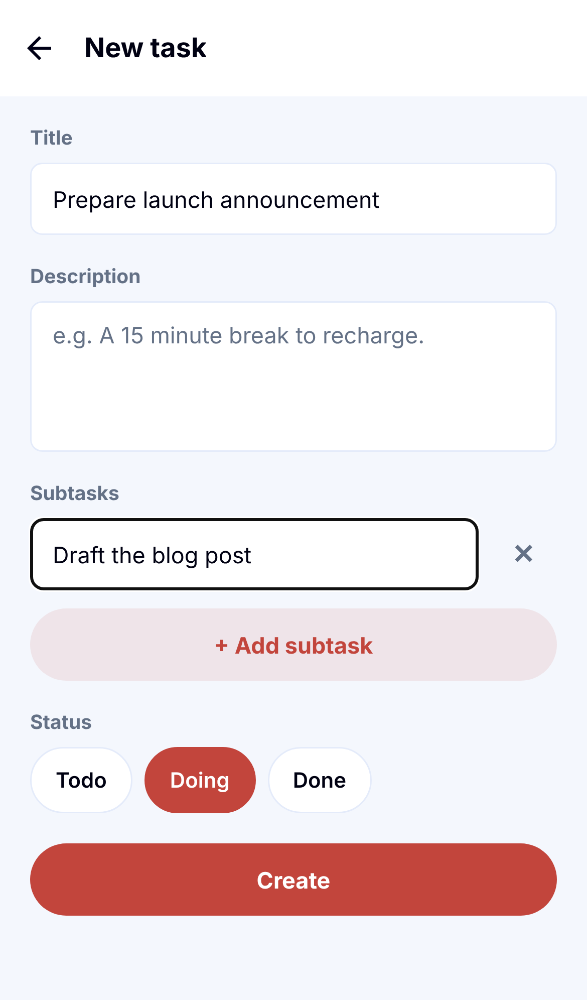
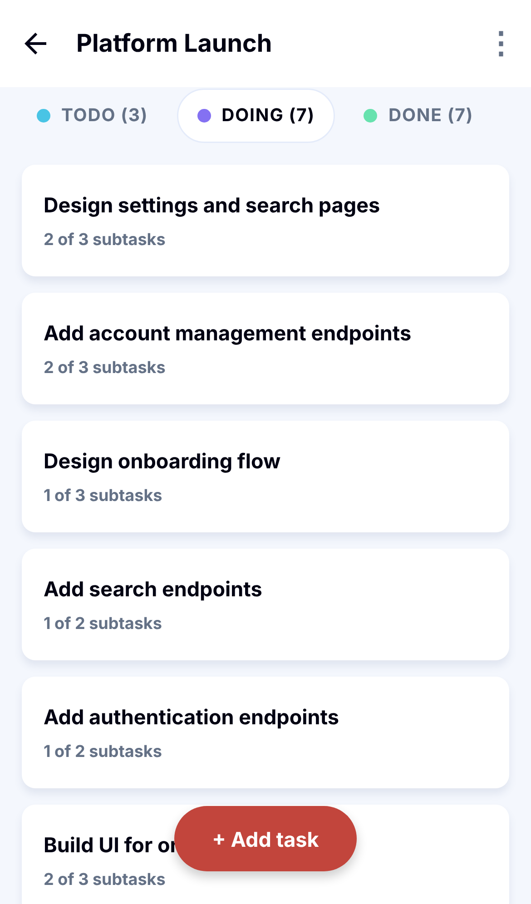
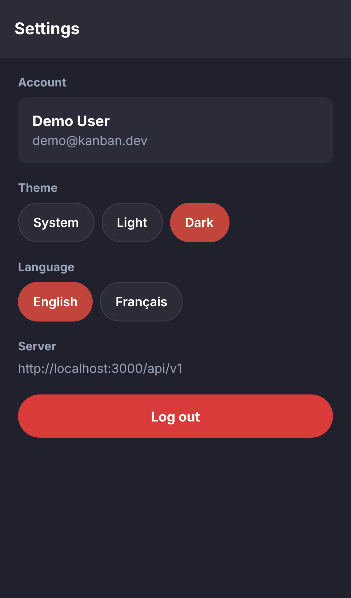
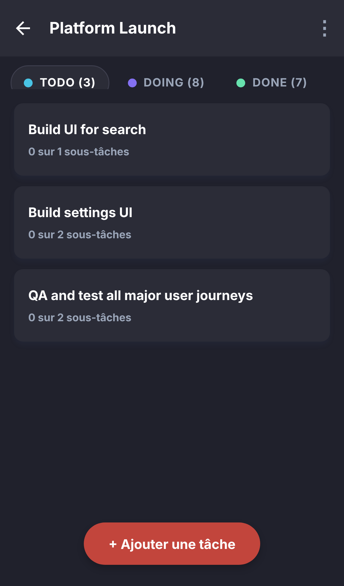
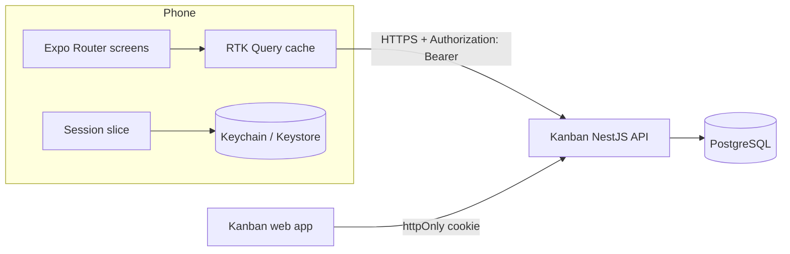

<div align="center">

# 📱 Kanban Mobile

**The Kanban task manager for iOS and Android.**
Expo + React Native + TypeScript · same account and boards as the [web app](https://github.com/your-github-username/Latest-Kanban-Projet) · English & French.

[](https://github.com/your-github-username/Kanban-Application-Mobile/actions/workflows/ci.yml)


**English** · [Français](README.fr.md)



</div>

---

## Table of contents

- [Overview](#overview)
- [Features](#features)
- [Screenshots](#screenshots)
- [Tech stack](#tech-stack)
- [Getting started](#getting-started)
- [Architecture](#architecture)
- [Security](#security)
- [Testing](#testing)
- [Project structure](#project-structure)
- [Roadmap](#roadmap)
- [License](#license)

## Overview

Kanban Mobile is the phone companion of the [Kanban Task Manager](https://github.com/your-github-username/Latest-Kanban-Projet). Both apps use **the same NestJS API**, so a task you create on your phone shows up in the browser, and the other way round.

Organise your projects into boards and columns (*Todo → Doing → Done*), open a task to tick its subtasks, and move it forward with one tap.

<p align="center"></p>

## Features

- 🔐 **Accounts**: sign up, log in, automatic session restore, log out
- 🗂️ **Boards**: create, rename, delete; add, rename, reorder and remove columns
- 👆 **Columns**: tabs with task counts, swipe left and right between columns, pull to refresh
- ✅ **Tasks & subtasks**: create, edit, delete, tick subtasks, progress on every card
- ↕️ **Move tasks**: change the status in one tap, reorder with *Move up / Move down*, with instant (optimistic) updates
- 🌍 **English / French**, following the phone's language by default
- 🌗 **Light / dark / system theme**
- ♿ **Accessible**: every control has a role, label and state for VoiceOver / TalkBack; 44 pt touch targets; WCAG AA colours
- 🧪 **33 automated tests** and CI on every push

## Screenshots

| Login | Boards | Board | Task |
|---|---|---|---|
|  |  |  |  |
| **New task** | **After moving a task** | **Settings (dark)** | **French, dark** |
|  |  |  |  |

## Tech stack

| Area | Technology |
|---|---|
| App | Expo SDK 58, React Native 0.88, React 19, TypeScript (strict) |
| Navigation | Expo Router (file-based routes, protected routes, modals) |
| Data | Redux Toolkit Query (cache, optimistic updates), Redux Toolkit |
| Storage | `expo-secure-store` (Keychain / Keystore) |
| i18n | Built-in English/French dictionaries, `expo-localization` |
| Backend | [Kanban NestJS API](https://github.com/your-github-username/Latest-Kanban-Projet) (`/auth/mobile/*` + Bearer token) |
| Tests | Jest (`jest-expo`), React Native Testing Library, Expo Router test utilities |
| Quality | ESLint, Prettier, GitHub Actions |

## Getting started

### Prerequisites

- **Node.js 24** (see `.nvmrc`)
- The **Kanban API** running. Follow the backend steps in the [web project](https://github.com/your-github-username/Latest-Kanban-Projet#getting-started) (`npm run seed` creates the demo account).
- To run on a phone: the free **Expo Go** app ([iOS](https://apps.apple.com/app/expo-go/id982107779) / [Android](https://play.google.com/store/apps/details?id=host.exp.exponent)), or an iOS simulator / Android emulator.

### 1. Install

```bash
npm install
cp .env.example .env
```

### 2. Point the app to the API

Edit `EXPO_PUBLIC_API_URL` in `.env`:

| Where the app runs | Value |
|---|---|
| iOS simulator or web | `http://localhost:3000/api/v1` |
| Android emulator | `http://10.0.2.2:3000/api/v1` |
| Your phone with Expo Go | `http://<your computer's IP>:3000/api/v1` (same Wi-Fi) |

### 3. Start

```bash
npm start          # then scan the QR code with Expo Go, or press i / a / w
```

Log in with **Use the demo account** (`demo@kanban.dev` / `Demo1234`), or create your own account.

## Architecture



- **Session.** At startup the app reads the token from secure storage. Expo Router's protected routes show login/sign-up or the app depending on the session, with no flash of private screens.
- **Expired session.** Any `401` from the API signs the user out, deletes the token and clears the cache.
- **Optimistic UI.** Ticking a subtask or moving a task updates the screen instantly, and rolls back if the server refuses.

## Security

| Topic | How it's handled |
|---|---|
| Token storage | `expo-secure-store`: iOS Keychain / Android Keystore, encrypted, never in plain AsyncStorage |
| Token transport | `Authorization: Bearer` header only; the mobile login sets no cookie |
| Expired or revoked token | Detected on the first `401`: session cleared, token deleted, back to login |
| Passwords | Validated on the device with the same rules as the API, hashed with scrypt on the server, never stored on the phone |
| Server-side protection | Rate-limited login, ownership checks on every query, input validation (see the [API's security section](https://github.com/your-github-username/Latest-Kanban-Projet#security)) |

> In production, serve the API over **HTTPS**. iOS and Android block plain HTTP by default outside development.

## Testing

```bash
npm test            # 33 tests
npm run test:ci     # with coverage
npm run typecheck
npm run lint
```

The tests render the **real screens through Expo Router** against an in-memory fake of the API, and cover:

- **Authentication:** login, wrong password, network error, sign-up, duplicate email, session restore, expired token
- **Boards:** list, open, tabs, create with validation, rename and add a column, delete with confirmation
- **Tasks:** details, ticking subtasks, changing status, Move up / Move down, create, edit, delete
- **Settings:** theme, language, logout; private screens are never shown when signed out
- **Helpers:** validation rules, translation completeness, optimistic move logic

## Project structure

```
.
├── app/                     Screens (Expo Router: one file = one route)
│   ├── _layout.tsx          Providers + protected navigator
│   ├── login.tsx, signup.tsx
│   ├── boards/index.tsx     Boards list
│   ├── boards/[boardId].tsx Board: column tabs + swipe
│   ├── task/[taskId].tsx    Task details (modal)
│   ├── task-form.tsx        Create / edit task (modal)
│   ├── board-form.tsx       Create / edit board (modal)
│   └── settings.tsx
├── src/
│   ├── api/                 RTK Query endpoints and types
│   ├── store/               Store, session slice, token persistence
│   ├── components/          Accessible UI kit (buttons, fields, chips, dialogs…)
│   ├── i18n/                English & French messages
│   ├── theme/               Light / dark palettes
│   └── features/            Form validation
├── __tests__/               Screen and unit tests
├── test/                    Fake API, render helper, secure-store mock
└── assets/                  App icon and splash
```

## Roadmap

- [ ] Drag and drop with a long press (React Native Gesture Handler + Reanimated)
- [ ] Offline mode with background sync
- [ ] Push notifications for due dates
- [ ] Store builds with EAS (TestFlight / Play Console)

## License

Released under the [MIT License](LICENSE).
